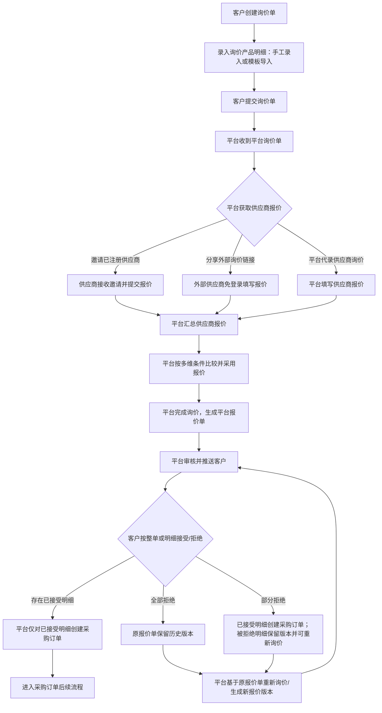

# 海赋农产品平台｜询报价业务流程梳理（客户确认稿）

**创建时间**：2026-08-24  
**功能模块**：询价、供应商报价、平台报价、采购订单衔接  
**文档版本**：v0.1（待确认）  
**范围说明**：依据询价业务流程图、客户/平台/供应商操作手册及已沟通规则整理；本稿只覆盖询报价闭环及其进入采购订单的条件，不展开采购履约、结算、开票。

## 1. 结论摘要

询价业务以**客户需求明细**为起点，以**客户对平台报价明细的接受/拒绝**为最终商业选择。平台负责组织供应商报价、综合比价、形成对客报价并审核；供应商负责对受邀产品报价。客户可按明细部分接受，平台只针对已接受的明细创建采购订单。

客户拒绝报价后，不新建独立询价单；应在原报价单基础上进入新版本的重新询价/重新报价流程，历史报价与供应商报价均保留，确保可追溯。

## 2. 角色与职责边界

| 角色 | 核心职责 | 可见/可操作对象 |
| --- | --- | --- |
| 客户 | 提出需求、查看平台报价、逐明细或整单作出接受/拒绝选择 | 自己发起的询价单、平台报价单、由已接受明细生成的采购订单 |
| 平台业务人员 | 接收询价、邀供应商/代录报价、综合比价、采用供应商报价、生成并审核对客报价、在客户选择后创建采购订单 | 平台询价单、供应商询价单、平台报价单、采购订单 |
| 已注册供应商 | 接收平台报价邀请并提交报价 | 被邀请的供应商询价单及对应产品明细 |
| 外部供应商 | 通过平台分享的小程序链接免登录填写报价 | 外部询价单及对应产品明细；能否进入正式采购须完成准入，详见待确认项 |

## 3. 已确认业务规则

1. **部分接受可下单**：客户可对报价单中的部分产品明细接受、部分拒绝；平台可仅将“已接受”的明细创建采购订单。
2. **拒绝后沿用原报价单并版本化**：客户拒绝后，在原报价单基础上保留版本记录并重新询价/报价；不得覆盖或删除历史报价、供应商报价和客户选择记录。
3. **平台综合比价，客户最终选择**：平台在选择供应商报价、形成平台报价时应参考价格以及供应商、交期、税率、运费、最小起订量、付款条件、报价有效期等维度；最终是否接受某项平台报价，由客户决定。
4. **可多供应商报价**：同一询价单/产品可邀请多个供应商；内部供应商和外部供应商的报价可在同一比价视图中比较。
5. **外部供应商免登录报价**：外部供应商可通过小程序分享链接填写报价，无需预先登录系统。

## 4. 主业务流程

### 4.1 分步骤说明

| 阶段 | 发起角色 | 页面/对象 | 操作与产物 | 流转规则 |
| --- | --- | --- | --- | --- |
| 1. 创建需求 | 客户 | 客户端-询价单 | 新建询价单；通过明细导入或手工维护产品 | 询价单至少应有一条有效产品明细后方可提交【待确认：必填字段】 |
| 2. 提交询价 | 客户 | 询价单详情 | 点击“提交” | 生成/进入平台询价单，推送平台业务人员处理 |
| 3. 组织报价 | 平台 | 平台询价单 | 邀请供应商报价；或填写供应商询价 | 可邀请多个供应商，并按供应商选择待报价产品 |
| 4. 供应商报价 | 内部/外部供应商 | 供应商询价单/外部询价单 | 填写产品价格及其他报价条件，提交报价 | 内部供应商通过供应商端；外部供应商通过分享链接；两类报价均进入平台比价池 |
| 5. 采用报价 | 平台 | 询价单详情-供应商询价 | 查看报价、比较、选择并“采用” | 采用动作应记录采用的供应商报价版本和采用理由【待确认：是否支持每条明细分别采用】 |
| 6. 对客报价 | 平台 | 平台报价单 | 询价完成后系统生成平台报价单；平台核对并审核 | 审核后才向客户展示/推送正式报价 |
| 7. 客户选择 | 客户 | 平台报价单 | 全部接受、全部拒绝，或逐条接受/拒绝 | 客户是最终选择方；每条明细都应留存选择结果、选择时间和操作人 |
| 8. 采购衔接 | 平台 | 平台报价单/采购订单 | 对已接受明细创建采购订单 | 支持部分接受后部分下单；拒绝明细不进入该采购订单 |
| 9. 重新询价 | 平台/客户触发 | 原报价单及其版本 | 针对被拒绝内容重新组织报价并形成新版本 | 保留原报价单、平台报价、供应商报价与客户拒绝记录；新版本回到客户选择环节 |

## 5. 关键分支与状态建议

### 5.1 客户选择分支

| 客户动作 | 平台报价单结果 | 采购订单结果 | 后续动作 |
| --- | --- | --- | --- |
| 全部接受 | 全部接受 | 所有已报价明细可进入采购订单 | 平台完成处理并创建采购订单 |
| 部分接受、部分拒绝 | 部分接受 | 仅接受明细创建采购订单 | 拒绝明细保留在原报价链路，按需重新询价 |
| 全部拒绝 | 全部拒绝 | 不创建采购订单 | 在原报价单基础上保留版本并重新询价/报价 |

### 5.2 建议的单据状态（待与现有系统状态码核对）

| 单据 | 建议状态序列 | 说明 |
| --- | --- | --- |
| 询价单 | 草稿 → 已提交 → 报价收集中 → 待采用 → 已完成询价 → 已生成报价/已关闭 | “已关闭”适用于撤销、过期或全部不再处理的场景【待确认】 |
| 供应商询价单 | 待报价 → 已报价 → 已采用/未采用 → 已失效 | 同一询价可能有多个供应商报价；采用状态宜精确到明细【待确认】 |
| 平台报价单 | 草稿 → 待审核 → 待客户确认 → 部分接受/全部接受/全部拒绝 → 已转采购（或重新询价中） | 版本维度须独立管理；不可用新版本覆盖历史版本 |
| 采购订单 | 待创建 → 已创建/已提交 | 仅承接客户已接受明细，后续履约状态沿用采购订单模块 |

## 6. 版本与追溯规则

1. 一个业务询价应有稳定的“询价主单号”；平台报价单以“主单号 + 版本号”管理，例如 V1、V2。
2. 客户拒绝后重新询价，应创建新的报价版本；旧版本只读保留，不能修改原报价金额、供应商选择及客户选择结果。
3. 新版本需能追溯到触发原因（客户拒绝/价格调整/交期调整等）、被重新询价的产品明细、重新邀约的供应商及各供应商报价版本。
4. 当客户部分接受时，已接受明细与其创建的采购订单建立关联；未接受明细才进入后续重新询价范围，避免重复下单。

## 7. 核心数据对象（字段层待补齐）

| 数据对象 | 应承载的信息 | 当前结论 |
| --- | --- | --- |
| 询价单 | 客户、询价产品明细、需求数量、需求条件、提交信息、当前状态 | 已有页面和导入能力；详细字段待补充 |
| 供应商报价 | 供应商、产品明细、价格、交期、税率、运费、最小起订量、付款条件、有效期、提交时间 | 多维比价的原始依据；具体字段定义待客户/业务确认 |
| 平台报价单 | 面向客户的产品明细、平台报价及报价条件、审核信息、版本号、客户确认结果 | 对客价格及字段清单待后续同步 |
| 采购订单 | 由客户已接受的平台报价明细转换而来，并保留来源报价单及版本 | 需防止同一已接受明细重复创建采购订单【待确认】 |

## 8. 待客户确认清单

以下事项会影响流程、权限、数据结构或页面交互，建议按优先级与客户确认。

| 优先级 | 待确认事项 | 建议确认口径 | 影响范围 |
| --- | --- | --- | --- |
| P0 | 外部供应商准入 | 外部供应商的报价被采用后，是否必须在创建正式采购订单前完成注册、企业认证、资质审核及签约？由谁发起/审核？未完成时是否禁止下单？ | 外部报价、供应商准入、采购订单 |
| P0 | 部分接受后的拒绝明细 | 客户部分接受后，被拒绝明细是否自动进入重新询价，还是由客户/平台手动发起？是否允许客户修改数量或需求条件后再询价？ | 版本、交互、采购拆分 |
| P0 | 采用粒度 | 平台“采用”是按整份供应商报价单，还是允许对每一产品明细分别采用不同供应商的报价？ | 比价、采购拆单、供应商协同 |
| P0 | 报价版本边界 | 哪些客户拒绝/平台调价/供应商重报场景必须新建版本？报价单有效期届满后的处理方式是什么？ | 历史追溯、状态、通知 |
| P1 | 对客报价字段 | 平台报价单的字段清单、哪些字段客户可见、哪些条件可修改、税运口径及金额计算规则。 | 报价页面、金额计算、客户选择 |
| P1 | 采购订单生成规则 | 部分接受时是一张订单承接所有接受明细，还是按供应商、交期、仓库、结算主体等自动拆单？是否支持平台手动调整拆单？ | 采购订单、履约、结算 |
| P1 | 报价接受后的系统动作 | 流程图标注“维护到客户产品库”后结束，客户手册则描述客户接受后等待平台审核并发起采购订单；请确认客户接受后是否同时维护客户产品库、是否必须由平台审核，以及两项动作的先后关系。 | 客户确认、产品库、采购订单 |
| P1 | 报价比较与排序 | 默认排序是否以含税到手价为主；交期、税率、运费、最小起订量、付款条件、有效期如何展示/比较；是否需要推荐标识及采用理由必填？ | 平台比价页、审计 |
| P1 | 撤销与超时 | 客户可否撤销已提交询价？供应商可否撤回/修改已提交报价？询价和报价的有效期、超时关闭及提醒规则。 | 状态、权限、消息通知 |
| P2 | 通知机制 | 提交、邀请、报价提交、报价审核、客户确认、到期等节点的站内信/短信/微信通知对象与频率。 | 体验、消息服务 |
| P2 | 权限与审计 | 客户侧哪些联系人可确认报价；平台侧谁可采用、审核、完成；是否要求审批留痕、电子签章或二次确认。 | 权限、安全、合规 |

## 9. 首轮验收口径

1. 客户可创建含多条产品明细的询价单，并能通过手工录入或模板导入后提交平台。
2. 平台可对同一产品邀请多个内部供应商，也可将外部询价链接分享给外部供应商；各方报价均能汇总查看。
3. 平台可基于多维报价条件选择报价，并生成经过审核的客户报价单。
4. 客户可整单接受/拒绝，也可逐条接受/拒绝；其选择结果可被平台准确查看。
5. 客户部分接受时，系统仅将已接受明细带入采购订单；被拒绝明细不会被带入订单。
6. 客户全部或部分拒绝后，系统可基于原报价单创建新的报价版本；历史版本及其供应商报价、客户选择记录可查询且不可被覆盖。
7. 外部供应商报价被采用但未满足准入条件时，系统按客户最终确认的规则阻止或提示创建正式采购订单。

## 10. 本轮边界

- 已覆盖：询价创建、供应商邀报价、外部报价、平台比价/采用、平台报价、客户确认、版本化重新询价、采购订单衔接。
- 暂不展开：采购订单审核、供应商发货、客户收货、账单、税票、支付及结算。
- 暂不固化：报价单具体字段、金额计算公式、状态码、消息模板、准入认证细则；待客户确认后进入详细功能设计。
